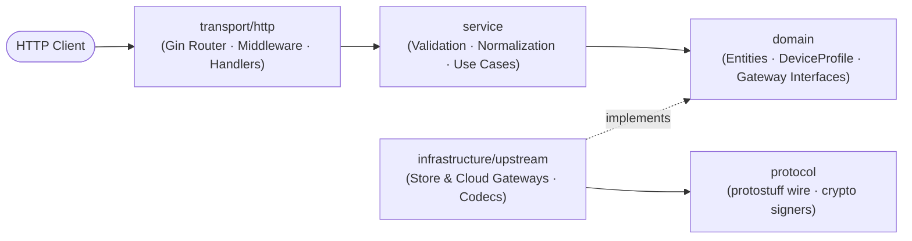

<div align="center">

# OWAS-API

**A clean, high-performance RESTful API server for the OPPO Watch App Store (`com.heytap.wearable.market`), built with Go 1.27.4 & Gin.**

[](https://go.dev/)
[](https://gin-gonic.com/)
[](#api-reference)
[](https://www.gnu.org/licenses/agpl-3.0.html)

**English** · [简体中文](README_ZH.md)

</div>

---

## Overview

**OWAS-API** exposes the complete capabilities of the **OPPO Watch App Store** (`com.heytap.wearable.market`, protocol baseline `8.0.0.23_90d713a_260910`) through a clean, well-typed **RESTful JSON API**.

Designed around standard Go project conventions and Clean Architecture, it handles binary Protostuff serialization, dynamic request signing, polymorphic card decoding, and RSA/AES-256-GCM key exchange transparently under the hood—requiring **no `protoc` compiler** and **no external cryptographic dependencies**.

### Key Highlights

- **Full App Store Coverage** — Search apps (fuzzy & exact), browse paginated home feeds & topic collections, inspect app details by ID or package name, retrieve signed APK download URLs & MD5 checksums, batch-check updates, fetch legal agreements, manage paid orders, query feature switches, and negotiate symmetric encryption keys.
- **Per-Request Watch Emulation** — Switch between round/square watch screens, Android/iOS paired phone perspectives, locale, and firmware versions dynamically via standard HTTP request headers.
- **Minimal Dependencies** — Only `github.com/gin-gonic/gin` is required directly; Protostuff wire encoding/decoding, MD5/HMAC-SHA256 signing, XXTEA, RSA-PKCS1v15, AES-256-GCM, structured `slog` logging, and graceful shutdown are implemented purely with the Go 1.27.4 standard library.
- **Decoupled & Testable** — Strict unidirectional dependency inversion (`transport -> service -> domain <- infrastructure`) makes caching, rate-limiting, or custom adapters drop-in extensions.

---

## Table of Contents

- [Architecture](#architecture)
- [Quick Start](#quick-start)
- [Configuration](#configuration)
- [API Conventions](#api-conventions)
  - [Response Envelope](#response-envelope)
  - [Status & Error Codes](#status--error-codes)
  - [Device Context & Auth Headers](#device-context--auth-headers)
- [API Reference](#api-reference)
  - [Endpoint Summary](#endpoint-summary)
  - [System Health](#1-system-health)
  - [Watch Store APIs](#2-watch-store-apis)
  - [Health Cloud APIs](#3-health-cloud-apis)
- [Enumerations & Reference Tables](#enumerations--reference-tables)
- [License](#license)
- [Disclaimer](#disclaimer)

---

## Architecture



```text
OWAS-API/
├── cmd/server/
│   └── main.go                      # Entrypoint: config loading, DI wiring, graceful shutdown
├── internal/
│   ├── config/                      # Environment variable loading & validation
│   ├── domain/                      # Entities, DeviceProfile value object, errors, gateway interfaces
│   ├── protocol/
│   │   ├── protostuff/              # Zero-dependency Protostuff wire codec (Tag 127 poly, map, group)
│   │   └── crypto/                  # Stdlib MD5, XXTEA, HMAC-SHA256, RSA-PKCS1v15, AES-256-GCM
│   ├── infrastructure/upstream/     # HTTP gateways & strongly-typed Protostuff/JSON codecs
│   ├── service/                     # Input validation, defaults & business status mapping
│   └── transport/http/
│       ├── router.go                # Gin route tree & global middleware chain
│       ├── response/                # Unified JSON envelope & domain error -> HTTP status mapper
│       ├── middleware/              # X-Request-ID, slog access logger, device context extractor
│       └── handler/                 # Store, Health Cloud & Healthz RESTful handlers
├── tests/
│   └── live_verify_test.go          # Opt-in live end-to-end verification suite (-tags=live)
├── .env.example                     # Sample environment configuration
├── go.mod                           # Go 1.27.4 module definition
├── README.md                        # English documentation
└── README_ZH.md                     # Chinese documentation
```

---

## Quick Start

### Prerequisites

- **Go `1.27.4`** or newer

### Run Locally

```bash
# 1. Enter the module directory
cd OWAS-API

# 2. Download dependencies
go mod download

# 3. Start the HTTP server (default: http://0.0.0.0:8080)
go run ./cmd/server
```

### Build Production Binary

```bash
go build -ldflags="-s -w" -o bin/owas-api ./cmd/server
./bin/owas-api
```

### Run Tests

```bash
# Run offline unit & HTTP router integration tests (fast, no external network needed)
go test -v ./...

# Run static analysis
go vet ./...

# Run opt-in live end-to-end verification across all endpoints (requires internet access)
go test -v -count=1 -tags=live ./tests/...
```

---

## Configuration

All runtime settings are configured via environment variables (see [.env.example](.env.example)).

| Variable | Default | Description |
| :--- | :--- | :--- |
| `OWAS_HOST` | `0.0.0.0` | Bind host address |
| `OWAS_PORT` | `8080` | Bind TCP port (`1`–`65535`) |
| `GIN_MODE` | `release` | Gin runtime mode: `debug`, `release`, or `test` |
| `OWAS_READ_TIMEOUT` | `15s` | HTTP server read timeout (Go duration format) |
| `OWAS_WRITE_TIMEOUT` | `30s` | HTTP server write timeout |
| `OWAS_IDLE_TIMEOUT` | `60s` | HTTP keep-alive idle timeout |
| `OWAS_SHUTDOWN_TIMEOUT` | `10s` | Graceful shutdown drain deadline |
| `OWAS_UPSTREAM_TIMEOUT` | `20s` | Per-request timeout for store/cloud requests |
| `OWAS_DEFAULT_WATCH_TYPE` | `2` | Default watch screen shape: `2` (round) or `1` (square) |
| `OWAS_DEFAULT_SUPPORT` | `android-oppo` | Default paired phone type: `android-oppo`, `android-others`, or `ios` |
| `OWAS_DEFAULT_LOCALE` | `zh-CN;CN` | Default watch locale (`<languageTag>;<country>`) |
| `OWAS_DEFAULT_BRAND` | `OPPO` | Default simulated watch brand |
| `OWAS_DEFAULT_PRODUCT` | `OWW251` | Default simulated watch product name |
| `OWAS_DEFAULT_MODEL` | `OWW251` | Default simulated watch model |
| `OWAS_DEFAULT_SDK_INT` | `30` | Default Android SDK integer (`> 0`) |
| `OWAS_DEFAULT_ANDROID_RELEASE` | `11` | Default Android OS release version |
| `OWAS_DEFAULT_HEY_RELEASE` | `4.0` | Default wearable framework release version |
| `OWAS_DEFAULT_COLOR_OS_VER` | `16` | Default ColorOS Watch version |
| `OWAS_DEFAULT_SYS_VER` | `OWW251_11_A.319` | Default system firmware display ID |
| `OWAS_DEFAULT_LINKAGE` | `1` | Default pairing mode: `1` (normal) or `0` (family device) |
| `OWAS_DEFAULT_PLAT_CODE` | `0` | Default Quick App engine versionCode (`>= 0`) |
| `OWAS_DEFAULT_INSTANT_SW_CLOSE` | `0` | Default Quick App switch: `0` (enabled) or `1` (disabled) |
| `OWAS_DEFAULT_TOKEN` | `""` | Optional default HeyTap user `accessToken` |

> [!TIP]
> You can also override the store/cloud service base URLs for local mocking or private proxies using `OWAS_APPSTORE_BASE_URL` and `OWAS_HEALTH_CLOUD_BASE_URL`.

---

## API Conventions

### Response Envelope

Every endpoint returns a consistent UTF-8 JSON envelope containing a correlation `requestId` (mirrored in the `X-Request-ID` HTTP response header).

**Success (`200 OK` / `201 Created`)**

```json
{
  "code": "OK",
  "message": "success",
  "requestId": "9a7f3c8e2b1d4a5f8e9c0d1a2b3c4d5e",
  "data": { }
}
```

**Error (`4xx` / `5xx`)**

```json
{
  "code": "INVALID_ARGUMENT",
  "message": "query parameter 'word' is required",
  "requestId": "9a7f3c8e2b1d4a5f8e9c0d1a2b3c4d5e",
  "details": {
    "field": "word"
  }
}
```

### Status & Error Codes

| HTTP Status | `code` | Meaning |
| :-: | :--- | :--- |
| `200` | `OK` | Request succeeded |
| `201` | `OK` | Resource created successfully (paid app order) |
| `400` | `INVALID_ARGUMENT` | Missing/malformed query, path, JSON body, or invalid `X-Watch-*` header |
| `401` | `UNAUTHORIZED` | Missing, expired, or invalid HeyTap account token |
| `404` | `NOT_FOUND` | Requested app, package, or version download resource does not exist |
| `404` | `ROUTE_NOT_FOUND` | Unmatched API route |
| `405` | `METHOD_NOT_ALLOWED` | HTTP method is not supported on this route |
| `502` | `UPSTREAM_ERROR` | Store service returned an unexpected status, protocol error, or business error code |
| `504` | `UPSTREAM_TIMEOUT` | Store service did not respond within `OWAS_UPSTREAM_TIMEOUT` |
| `500` | `INTERNAL_ERROR` | Unexpected internal server error |

### Device Context & Auth Headers

All `/api/v1/*` routes accept optional HTTP headers to override the default watch profile on a per-request basis. Invalid header values immediately fail fast with `400 Bad Request`.

| Header | Allowed Values / Format | Default | Description |
| :--- | :--- | :--- | :--- |
| `X-Watch-Type` | `"1"`, `"2"` | `"2"` | Watch screen form factor: **`1`** = Square watch, **`2`** = Round watch. *Affects app catalog filtering.* |
| `X-Watch-Support` | `"android-oppo"`, `"android-others"`, `"ios"` | `"android-oppo"` | Paired phone platform: **`android-oppo`** (fullest catalog), **`android-others`** (third-party Android), **`ios`** (iPhone-compatible apps only). *Affects app catalog filtering.* |
| `X-Watch-Locale` | `<langTag>;<country>` | `"zh-CN;CN"` | Watch locale & region |
| `X-Watch-Brand` | string | `"OPPO"` | Watch manufacturer brand |
| `X-Watch-Product` | string | `"OWW251"` | Watch product code |
| `X-Watch-Model` | string | `"OWW251"` | Watch model identifier |
| `X-Watch-SDK-Int` | integer (`> 0`) | `30` | Android SDK API level |
| `X-Watch-Android-Release` | string | `"11"` | Android OS version string |
| `X-Watch-Hey-Release` | string | `"4.0"` | Wearable framework version |
| `X-Watch-ColorOS-Ver` | string | `"16"` | ColorOS Watch major version |
| `X-Watch-Sys-Ver` | string | `"OWW251_11_A.319"` | System firmware build ID |
| `X-Watch-Linkage` | `"0"`, `"1"` | `"1"` | Pairing mode: **`0`** = Family-paired watch, **`1`** = Standard pairing |
| `X-Watch-Plat-Code` | integer (`>= 0`) | `0` | Quick App engine `versionCode` (`0` = not installed) |
| `X-Watch-Instant-Sw-Close` | `"0"`, `"1"` | `"0"` | Quick App toggle: **`0`** = Enabled, **`1`** = Disabled |
| `Authorization` | `Bearer <accessToken>` | *(none)* | HeyTap account token for authenticated endpoints |
| `X-HeyTap-Token` | `<accessToken>` | *(none)* | Alternative HeyTap token header (takes precedence over `Authorization`) |
| `X-Request-ID` | string (`<= 128` chars) | *(auto UUID)* | Custom trace ID echoed in response header & envelope |

> [!NOTE]
> The App Store actively filters results based on `X-Watch-Type` and `X-Watch-Support`. For example, searching `"微信"` with `X-Watch-Type: 2` + `X-Watch-Support: android-oppo` returns the broadest catalog, whereas `X-Watch-Type: 1` (square) or `X-Watch-Support: ios` filters out incompatible apps.

---

## API Reference

### Endpoint Summary

| Method | Endpoint | Description | Auth |
| :-: | :--- | :--- | :-: |
| `GET` | [`/healthz`](#get-healthz) | Service liveness & runtime info | Public |
| `GET` | [`/api/v1/apps`](#1-search-apps) | Search watch apps by keyword | Public |
| `GET` | [`/api/v1/apps/:appId`](#2-get-app-detail-by-id) | Get full app detail by numeric `appId` | Public |
| `GET` | [`/api/v1/packages/:pkgName`](#3-get-app-detail-by-package-name) | Get full app detail by Android package name | Public |
| `GET` | [`/api/v1/apps/:appId/versions/:verId/download`](#4-get-apk-download-info) | Get signed APK CDN download URL & MD5 checksums | Public |
| `POST` | [`/api/v1/updates/check`](#5-batch-check-app-updates) | Batch check installed apps for available updates | Public |
| `GET` | [`/api/v1/home`](#6-get-home-page-cards) | Get paginated store home page card feed | Public |
| `GET` | [`/api/v1/subjects/:subjectId`](#7-get-subject--collection-detail) | Get curated topic/subject collection page | Public |
| `GET` | [`/api/v1/protocols`](#8-get-privacy-policy--user-agreement) | Get privacy policy & user agreement URLs | Public |
| `POST` | [`/api/v1/orders`](#9-create-paid-app-order) | Create a paid watch app order | **Token** |
| `GET` | [`/api/v1/orders/:orderId`](#10-query-order-payment-status) | Query payment status of an existing order | **Token** |
| `GET` | [`/api/v1/payments/status`](#11-batch-query-app-purchase-status) | Batch query whether apps are purchased | **Token** |
| `GET` | [`/api/v1/health-cloud/switches/:switchType`](#1-query-feature-switch-status) | Query remote feature switch & JSON config | Public |
| `POST` | [`/api/v1/health-cloud/pay-checks`](#2-verify-third-party-paid-app-license) | Verify third-party paid app license (RSA + AES-GCM) | **Token** |
| `POST` | [`/api/v1/health-cloud/symmetric-keys/exchange`](#3-exchange-symmetric-encryption-key) | Negotiate AES-256-GCM symmetric key | Public |

---

### 1. System Health

#### `GET /healthz`

Returns service liveness status, API version, and Go runtime version.

```bash
curl -s http://localhost:8080/healthz
```

<details>
<summary><b>Example Response — <code>200 OK</code></b></summary>

```json
{
  "code": "OK",
  "message": "success",
  "requestId": "4f8a9c12d3e44567890abcdef1234567",
  "data": {
    "goVersion": "go1.27.4",
    "service": "owas-api",
    "status": "ok",
    "version": "1.0.0"
  }
}
```

</details>

---

### 2. Watch Store APIs

#### 1. Search Apps

`GET /api/v1/apps`

Search watch applications by keyword. Returns all matching apps in a single response (not paginated).

| Location | Parameter | Type | Required | Default | Allowed Values & Meaning |
| :--- | :--- | :--- | :-: | :--- | :--- |
| Query | `word` | `string` | **Yes** | — | Search keyword (UTF-8 URL-encoded). Cannot be blank. |
| Query | `type` | `int` | No | `0` | **`0`** = Fuzzy / full-text search (matches title, description & keywords)<br>**`1`** = Exact app-name match<br>**`2`** = Extended search (same behavior as `0`) |

```bash
# Fuzzy search (default round watch + android-oppo)
curl -s "http://localhost:8080/api/v1/apps?word=%E5%BE%AE%E4%BF%A1&type=0"

# Exact match with square watch + iOS pairing filter
curl -s -H "X-Watch-Type: 1" -H "X-Watch-Support: ios" \
  "http://localhost:8080/api/v1/apps?word=%E5%BE%AE%E4%BF%A1&type=1"
```

<details>
<summary><b>Example Response — <code>200 OK</code></b></summary>

```json
{
  "code": "OK",
  "message": "success",
  "requestId": "b8c4e0f2a1d34567890123456789abcd",
  "data": {
    "apps": [
      {
        "appId": 31617863,
        "verId": 25869985,
        "appName": "微信",
        "pkgName": "com.tencent.watchwechat",
        "verName": "1.0.7",
        "verCode": 65543,
        "iconUrl": "https://watch.heytapimage.com/img/202403/26/d1d6f65e5b89ec3612d48cc233c3d87b.png",
        "size": 56637679,
        "sizeDesc": "54.0MB",
        "dlCount": 0,
        "desc": "通过微信手表版可以实时获取消息通知并回复，以及通过微信支付进行付款，帮助你轻松连接全球好友。",
        "screenshots": [
          "https://watch.heytapimage.com/img/202403/26/da0b3d7b04e73bc7482cf06780fa7a33.png"
        ],
        "md5": "ca4be7d3a8f73ac064186b3db8fafb95",
        "shortDesc": "微信手表版",
        "onlineTime": 1785916638000,
        "type": 12,
        "englishName": "Wechat",
        "privacyPolicy": "https://weixin.qq.com/cgi-bin/readtemplate?lang=zh_CN&t=weixin_agreement&s=privacy",
        "privacyRights": "录音或通话录音,数据网络开关,WLAN网络开关,使用摄像头,蓝牙开关",
        "versionExplain": "修复了一些已知问题。",
        "iphoneLink": 2,
        "iphoneLinkDetail": "微信 8.0.48",
        "ageRating": "12+",
        "payment": 0,
        "price": 0,
        "isBought": 0
      }
    ],
    "isEnd": 0
  }
}
```

</details>

---

#### 2. Get App Detail by ID

`GET /api/v1/apps/:appId`

Retrieve complete application metadata, developer details, and categorized permissions by numeric `appId`. Returns `404 NOT_FOUND` if the app does not exist or has been removed.

| Location | Parameter | Type | Required | Default | Allowed Values & Meaning |
| :--- | :--- | :--- | :-: | :--- | :--- |
| Path | `appId` | `int64` | **Yes** | — | Positive numeric application ID (e.g., `31617863`) |
| Query | `appType` | `int` | No | `1` | **`1`** = Standard APK application<br>**`2`** = Quick App (Instant App) |
| Query | `query` | `int` | No | `0` | Non-negative query flag (standard clients use `0`) |
| Query | `module` | `string` | No | `"home"` | Navigation source tag: `"home"`, `"topic"`, `"search"`, `"download"`, `"upgrade"`, `"notification"`, `"action"`, `"mmi"`, or `""` |

```bash
curl -s "http://localhost:8080/api/v1/apps/31617863?appType=1&module=search"
```

<details>
<summary><b>Example Response — <code>200 OK</code> &amp; <code>404 Not Found</code></b></summary>

**`200 OK`**

```json
{
  "code": "OK",
  "message": "success",
  "requestId": "c1d2e3f4a5b64789901234567890abcd",
  "data": {
    "base": {
      "appId": 31617863,
      "verId": 25869985,
      "appName": "微信",
      "pkgName": "com.tencent.watchwechat",
      "verName": "1.0.7",
      "verCode": 65543,
      "iconUrl": "https://watch.heytapimage.com/img/202403/26/d1d6f65e5b89ec3612d48cc233c3d87b.png",
      "size": 56637679,
      "sizeDesc": "54.0MB",
      "dlCount": 0,
      "md5": "ca4be7d3a8f73ac064186b3db8fafb95",
      "shortDesc": "微信手表版",
      "onlineTime": 1785916638000,
      "type": 12,
      "ageRating": "12+",
      "payment": 0,
      "price": 0,
      "isBought": 0
    },
    "developer": {
      "releaseTime": 1785916638000,
      "pkgPermiss": "android.permission.INTERNET,android.permission.RECORD_AUDIO",
      "developer": "深圳市腾讯计算机系统有限公司"
    },
    "permissionDto": {
      "basePermission": [
        "查看WLAN连接",
        "完全的网络访问权限"
      ],
      "privacyPermission": [
        "录音",
        "拍摄照片和视频"
      ]
    }
  }
}
```

**`404 Not Found`** (when `appId` does not exist)

```json
{
  "code": "NOT_FOUND",
  "message": "store.appDetailByID: resource not found",
  "requestId": "d4e5f6a7b8c9401234567890abcdef12"
}
```

</details>

---

#### 3. Get App Detail by Package Name

`GET /api/v1/packages/:pkgName`

Retrieve complete application metadata, developer details, and permissions by Android package name. Returns `404 NOT_FOUND` if the package is not listed in the store.

| Location | Parameter | Type | Required | Default | Allowed Values & Meaning |
| :--- | :--- | :--- | :-: | :--- | :--- |
| Path | `pkgName` | `string` | **Yes** | — | Android package name (e.g., `com.tencent.watchwechat`) |
| Query | `query` | `int` | No | `0` | Non-negative query flag (default `0`) |
| Query | `module` | `string` | No | `"action"` | Source module tag (`"action"`, `"home"`, `"search"`, `"topic"`, `"download"`, `"upgrade"`, `"notification"`, `"mmi"`) |

```bash
curl -s "http://localhost:8080/api/v1/packages/com.tencent.watchwechat?module=action"
```

<details>
<summary><b>Example Response — <code>200 OK</code></b></summary>

```json
{
  "code": "OK",
  "message": "success",
  "requestId": "1122334455664778899aabbccddeeff0",
  "data": {
    "base": {
      "appId": 31617863,
      "verId": 25869985,
      "appName": "微信",
      "pkgName": "com.tencent.watchwechat",
      "verName": "1.0.7",
      "verCode": 65543,
      "size": 56637679,
      "sizeDesc": "54.0MB",
      "type": 12,
      "payment": 0,
      "price": 0,
      "isBought": 0
    },
    "developer": {
      "releaseTime": 1785916638000,
      "developer": "深圳市腾讯计算机系统有限公司"
    },
    "permissionDto": {
      "basePermission": ["完全的网络访问权限"],
      "privacyPermission": ["录音"]
    }
  }
}
```

</details>

---

#### 4. Get APK Download Info

`GET /api/v1/apps/:appId/versions/:verId/download`

Fetch the temporary signed CDN download URL along with full-file MD5 and APK header MD5 checksums. Returns `404 NOT_FOUND` if the resource is unavailable.

| Location | Parameter | Type | Required | Default | Allowed Values & Meaning |
| :--- | :--- | :--- | :-: | :--- | :--- |
| Path | `appId` | `int64` | **Yes** | — | Positive numeric application ID |
| Path | `verId` | `int64` | **Yes** | — | Positive numeric version ID (from `Resource.verId`) |
| Query | `type` | `string` | No | `"1"` | Download trigger type:<br>**`"1"`** = Normal download<br>**`"2"`** = Manual upgrade<br>**`"3"`** = Automatic background upgrade |
| Query | `retry` | `int` | No | `2` | Retry attempt counter (`1`–`10`; watch clients start at `2`) |

```bash
curl -s "http://localhost:8080/api/v1/apps/31617863/versions/25869985/download?type=1&retry=2"
```

<details>
<summary><b>Example Response — <code>200 OK</code></b></summary>

```json
{
  "code": "OK",
  "message": "success",
  "requestId": "2233445566774889900aabbccddeeff1",
  "data": {
    "appId": 31617863,
    "verId": 25869985,
    "downUrl": "https://storefs1.nearme.com.cn/apk/202608/05/0bc75460de852adca20691f214fc30a3.apk?sign=...&t=...",
    "md5": "ca4be7d3a8f73ac064186b3db8fafb95",
    "headerMd5": "95d7eb481596fc790fc40ca436c03e9a",
    "pkgName": "com.tencent.watchwechat"
  }
}
```

</details>

---

#### 5. Batch Check App Updates

`POST /api/v1/updates/check`

Check up to 200 installed packages for newer versions in a single request.

| Field | Type | Required | Constraints & Meaning |
| :--- | :--- | :-: | :--- |
| `apps` | `array<object>` | **Yes** | `1` to `200` installed app items |
| `apps[].pkgName` | `string` | **Yes** | Installed Android package name |
| `apps[].verCode` | `string` | **Yes** | Installed integer `versionCode` formatted as a decimal string (e.g., `"1"`) |

> [!NOTE]
> For each recognized package, the response returns its latest metadata with `upgradeFlag`: **`1`** means a newer version is available; **`0`** means the installed version is already up to date. Packages not listed in the store are omitted from `upgrades`.

```bash
curl -s -X POST http://localhost:8080/api/v1/updates/check \
  -H "Content-Type: application/json" \
  -d '{
    "apps": [
      { "pkgName": "com.tencent.watchwechat", "verCode": "1" },
      { "pkgName": "com.koudaistory.watch", "verCode": "999999" }
    ]
  }'
```

<details>
<summary><b>Example Response — <code>200 OK</code></b></summary>

```json
{
  "code": "OK",
  "message": "success",
  "requestId": "3344556677884990011aabbccddeeff2",
  "data": {
    "upgrades": [
      {
        "appId": 31617863,
        "verId": 25869985,
        "appName": "微信",
        "pkgName": "com.tencent.watchwechat",
        "verName": "1.0.7",
        "verCode": 65543,
        "size": 56637679,
        "sizeDesc": "54.0MB",
        "md5": "ca4be7d3a8f73ac064186b3db8fafb95",
        "type": 12,
        "payment": 0,
        "price": 0,
        "isBought": 0,
        "updateDesc": "修复了一些已知问题。",
        "upgradeFlag": 1
      },
      {
        "appId": 31618001,
        "verId": 25870100,
        "appName": "口袋故事",
        "pkgName": "com.koudaistory.watch",
        "verName": "2.3.1",
        "verCode": 20301,
        "size": 18245120,
        "sizeDesc": "17.4MB",
        "type": 12,
        "payment": 0,
        "price": 0,
        "isBought": 0,
        "upgradeFlag": 0
      }
    ]
  }
}
```

</details>

---

#### 6. Get Home Page Cards

`GET /api/v1/home`

Fetch the paginated store home screen card feed. Cards are polymorphic (`NavCardDto`, `BannerCardDto`, `ResourceListCardDto`) and automatically decoded with their concrete `_type` and fields.

| Location | Parameter | Type | Required | Default | Allowed Values & Meaning |
| :--- | :--- | :--- | :-: | :--- | :--- |
| Query | `start` | `int` | No | `0` | Card offset (`>= 0`, typically increments in steps of `10`: `0, 10, 20...`) |
| Query | `size` | `int` | No | `10` | Cards per page (`1`–`100`) |

> [!TIP]
> Stop paginating when `data.isEnd == 1`. To inspect any topic/collection linked from a card or banner, extract `pk=6000<id>` from `actionParam` (for example, `pk=600087` corresponds to `subjectId = 87`).

```bash
curl -s "http://localhost:8080/api/v1/home?start=0&size=10"
```

<details>
<summary><b>Example Response — <code>200 OK</code></b></summary>

```json
{
  "code": "OK",
  "message": "success",
  "requestId": "4455667788994001122aabbccddeeff3",
  "data": {
    "pageKey": 100,
    "isEnd": 0,
    "cards": [
      {
        "_type": "com.heytap.appstore.watch.domain.v2.NavCardDto",
        "code": 1001,
        "key": 5001,
        "banners": [
          {
            "id": 9001,
            "image": "https://watch.heytapimage.com/img/202609/banner.png",
            "imageWidth": 720,
            "imageHeight": 360,
            "actionParam": "oap://mk/cardstyle?pk=600087",
            "title": "最近上新",
            "sort": 1
          }
        ]
      },
      {
        "_type": "com.heytap.appstore.watch.domain.v2.ResourceListCardDto",
        "code": 1002,
        "key": 600060,
        "actionParam": "oap://mk/cardstyle?pk=600060",
        "title": "推荐应用",
        "resources": [
          {
            "appId": 31617863,
            "verId": 25869985,
            "appName": "微信",
            "pkgName": "com.tencent.watchwechat",
            "verName": "1.0.7",
            "verCode": 65543,
            "size": 56637679,
            "sizeDesc": "54.0MB",
            "type": 12,
            "payment": 0,
            "price": 0,
            "isBought": 0
          }
        ]
      }
    ]
  }
}
```

</details>

---

#### 7. Get Subject / Collection Detail

`GET /api/v1/subjects/:subjectId`

Fetch the card feed for a specific curated topic/collection (e.g., "Recently Added", "Health & Fitness", "Utilities").

| Location | Parameter | Type | Required | Default | Allowed Values & Meaning |
| :--- | :--- | :--- | :-: | :--- | :--- |
| Path | `subjectId` | `int64` | **Yes** | — | Positive subject ID (derived by removing prefix `6000` from `pk=6000{id}`, e.g., `87` or `60`) |

```bash
curl -s "http://localhost:8080/api/v1/subjects/87"
```

<details>
<summary><b>Example Response — <code>200 OK</code></b></summary>

```json
{
  "code": "OK",
  "message": "success",
  "requestId": "5566778899004112233aabbccddeeff4",
  "data": {
    "pageKey": 101,
    "isEnd": 1,
    "cards": [
      {
        "_type": "com.heytap.appstore.watch.domain.v2.ResourceListCardDto",
        "code": 1006,
        "key": 600087,
        "title": "最近上新",
        "resources": [
          {
            "appId": 37627586,
            "verId": 26104210,
            "appName": "腕上实验室",
            "pkgName": "com.example.watchlab",
            "verName": "1.2.0",
            "verCode": 120,
            "size": 8421376,
            "sizeDesc": "8.0MB",
            "type": 12,
            "payment": 1,
            "price": 600,
            "isBought": 0
          }
        ]
      }
    ]
  }
}
```

</details>

---

#### 8. Get Privacy Policy & User Agreement

`GET /api/v1/protocols`

Retrieve the store's privacy policy URL, user agreement URL, and current privacy policy version number.

| Location | Parameter | Type | Required | Default | Allowed Values & Meaning |
| :--- | :--- | :--- | :-: | :--- | :--- |
| Query | `language` | `string` | No | `"zh_CN"` | Locale/language tag such as `"zh_CN"`, `"en_US"` |

```bash
curl -s "http://localhost:8080/api/v1/protocols?language=zh_CN"
```

<details>
<summary><b>Example Response — <code>200 OK</code></b></summary>

```json
{
  "code": "OK",
  "message": "success",
  "requestId": "6677889900114223344aabbccddeeff5",
  "data": {
    "privacy": "https://activity-cdo.heytapimage.com/cdo-activity/static/202205/23/store-VersionControl/latest.html?c=0&agreementType=5",
    "agreement": "https://cdofs.oppomobile.com/cdo-activity/static/2019/heytap/china/store/agreement.html?uLang=zh_CN",
    "privacyVersion": 1
  }
}
```

</details>

---

#### 9. Create Paid App Order

`POST /api/v1/orders` · **`Requires HeyTap Token`**

Create a payment order for a paid watch application.

> [!IMPORTANT]
> Requires a valid HeyTap `accessToken` supplied via `Authorization: Bearer <token>`, `X-HeyTap-Token`, or the JSON body `token` field (automatically synchronized across header and payload). Missing or invalid tokens return `401 UNAUTHORIZED`.

| Field | Type | Required | Constraints & Meaning |
| :--- | :--- | :-: | :--- |
| `appId` | `int64` | **Yes** | Positive numeric ID of the paid app |
| `price` | `int32` | **Yes** | Price in **fen (CNY cents)** (`>= 0`, e.g., `600` = ¥6.00) |
| `productName` | `string` | **Yes** | Product display name (typically `appName`) |
| `productDesc` | `string` | **Yes** | Product description (typically `pkgName`) |
| `token` | `string` | No | Optional HeyTap `accessToken` (falls back to header token) |
| `model` | `string` | No | Optional reserved device model field |
| `ip` | `string` | No | Optional reserved client IP field |

```bash
curl -s -X POST http://localhost:8080/api/v1/orders \
  -H "Authorization: Bearer <your_heytap_token>" \
  -H "Content-Type: application/json" \
  -d '{
    "appId": 37627586,
    "price": 600,
    "productName": "腕上实验室",
    "productDesc": "com.example.watchlab"
  }'
```

<details>
<summary><b>Example Response — <code>201 Created</code> &amp; <code>401 Unauthorized</code></b></summary>

**`201 Created`**

```json
{
  "code": "OK",
  "message": "created",
  "requestId": "7788990011224334455aabbccddeeff6",
  "data": {
    "orderId": "20261118193000123456",
    "payUrl": "https://pay.heytap.com/qr?token=...",
    "expireTime": "2026-11-18 19:45:00",
    "prePayToken": "prepay_token_example",
    "partnerCode": "PARTNER_001",
    "userId": "1000123456"
  }
}
```

**`401 Unauthorized`** (missing or invalid token)

```json
{
  "code": "UNAUTHORIZED",
  "message": "token校验未通过",
  "requestId": "7788990011224334455aabbccddeeff7",
  "details": {
    "upstreamCode": "302",
    "upstreamMessage": "token校验未通过"
  }
}
```

</details>

---

#### 10. Query Order Payment Status

`GET /api/v1/orders/:orderId` · **`Requires HeyTap Token`**

Poll payment status for an existing paid-app order.

| Location | Parameter | Type | Required | Default | Allowed Values & Meaning |
| :--- | :--- | :--- | :-: | :--- | :--- |
| Path | `orderId` | `string` | **Yes** | — | Order ID returned when creating the order |
| Query | `userId` | `string` | **Yes** | — | HeyTap account `userId` / `ssoid` |
| Query | `appId` | `int64` | **Yes** | — | Positive numeric application ID |

```bash
curl -s -H "Authorization: Bearer <your_heytap_token>" \
  "http://localhost:8080/api/v1/orders/20261118193000123456?userId=1000123456&appId=37627586"
```

<details>
<summary><b>Example Response — <code>200 OK</code></b></summary>

```json
{
  "code": "OK",
  "message": "success",
  "requestId": "8899001122334445566aabbccddeeff7",
  "data": {
    "appId": 37627586,
    "payStatus": 1
  }
}
```

> See [PayStatus Enumeration](#paystatus) for all `payStatus` values (`0`–`7`).

</details>

---

#### 11. Batch Query App Purchase Status

`GET /api/v1/payments/status` · **`Requires HeyTap Token`**

Query whether one or more paid applications have been purchased by the authenticated user.

| Location | Parameter | Type | Required | Default | Allowed Values & Meaning |
| :--- | :--- | :--- | :-: | :--- | :--- |
| Query | `appIds` | `string` | **Yes** | — | Comma-separated positive integer `appId` list (`1`–`100` IDs, e.g., `31617863,37627586`) |

```bash
curl -s -H "Authorization: Bearer <your_heytap_token>" \
  "http://localhost:8080/api/v1/payments/status?appIds=31617863,37627586"
```

<details>
<summary><b>Example Response — <code>200 OK</code></b></summary>

```json
{
  "code": "OK",
  "message": "success",
  "requestId": "9900112233444556677aabbccddeeff8",
  "data": {
    "statusVOList": [
      { "appId": 31617863, "payStatus": 0 },
      { "appId": 37627586, "payStatus": 1 }
    ]
  }
}
```

</details>

---

### 3. Health Cloud APIs

#### 1. Query Feature Switch Status

`GET /api/v1/health-cloud/switches/:switchType`

Query a remote feature switch configuration. When `body.config` contains valid JSON, OWAS-API automatically parses it into `body.parsedConfig`.

| Location | Parameter | Type | Required | Default | Allowed Values & Meaning |
| :--- | :--- | :--- | :-: | :--- | :--- |
| Path | `switchType` | `int` | **Yes** | — | Positive remote switch type ID (e.g., **`116`** = high-power consumption dialog configuration) |

```bash
curl -s "http://localhost:8080/api/v1/health-cloud/switches/116"
```

<details>
<summary><b>Example Response — <code>200 OK</code></b></summary>

```json
{
  "code": "OK",
  "message": "success",
  "requestId": "aa11bb22cc33444556677889900aabb1",
  "data": {
    "errorCode": 0,
    "message": "成功",
    "body": {
      "switchStatus": 1,
      "config": "{\"showPowerDialog\":true}",
      "parsedConfig": {
        "showPowerDialog": true
      }
    }
  }
}
```

</details>

---

#### 2. Verify Third-Party Paid App License

`POST /api/v1/health-cloud/pay-checks` · **`Requires HeyTap Token`**

Verify third-party watch app purchase authorization. Supports two modes:

1. **Managed crypto mode** — Provide `publicKey` (omit `cipher`): OWAS-API automatically generates a random 128-bit AES key, encrypts it with `RSA/ECB/PKCS1Padding`, submits the request, and AES-GCM-decrypts the response into `decryptedBody`.
2. **Pass-through mode** — Provide a pre-encrypted `cipher` directly.

| Field | Type | Required | Constraints & Meaning |
| :--- | :--- | :-: | :--- |
| `appId` | `int64` | **Yes** | Positive numeric ID of the paid app to verify |
| `cipher` | `string` | No | Pre-encrypted `Base64(RSA(aesKey))` string (optional in managed mode) |
| `publicKey` | `string` | No | Base64-encoded X.509 (SPKI DER) RSA public key (enables automatic encryption & response decryption when `cipher` is omitted) |

```bash
curl -s -X POST http://localhost:8080/api/v1/health-cloud/pay-checks \
  -H "Authorization: Bearer <your_heytap_token>" \
  -H "Content-Type: application/json" \
  -d '{
    "appId": 37627586,
    "publicKey": "<Base64_X509_RSA_Public_Key>"
  }'
```

<details>
<summary><b>Example Response — <code>200 OK</code> &amp; <code>401 Unauthorized</code></b></summary>

**`200 OK`** (managed mode with `publicKey`)

```json
{
  "code": "OK",
  "message": "success",
  "requestId": "bb22cc33dd444556677889900aabbcc2",
  "data": {
    "errorCode": 0,
    "message": "成功",
    "body": "<Base64_AES_GCM_Ciphertext>",
    "decryptedBody": [
      {
        "appid": 37627586,
        "payStatus": 1
      }
    ]
  }
}
```

**`401 Unauthorized`** (without valid token)

```json
{
  "code": "UNAUTHORIZED",
  "message": "health.checkPay: valid HeyTap token required",
  "requestId": "bb22cc33dd444556677889900aabbcc3",
  "details": {
    "upstreamStatus": 403
  }
}
```

</details>

---

#### 3. Exchange Symmetric Encryption Key

`POST /api/v1/health-cloud/symmetric-keys/exchange`

Negotiate a 256-bit symmetric key for encrypted special-app downloads. OWAS-API handles client key generation, RSA-PKCS1v15 payload encryption, HMAC-SHA256 request signing, and AES-256-GCM response decryption automatically.

| Field | Type | Required | Default | Allowed Values & Meaning |
| :--- | :--- | :-: | :--- | :--- |
| `encryptionAlgorithm` | `int` | No | `4` | Positive algorithm identifier (**`4`** = AES-256-GCM) |
| `firstExchangeKey` | `int` | No | `0` | Non-negative flag: **`0`** = standard negotiation, **`1`** = initial key exchange |

> [!TIP]
> The JSON body is entirely optional—sending an empty `POST` body uses the standard defaults (`encryptionAlgorithm = 4`, `firstExchangeKey = 0`).

```bash
# Using default parameters (empty body)
curl -s -X POST http://localhost:8080/api/v1/health-cloud/symmetric-keys/exchange

# Or with explicit parameters
curl -s -X POST http://localhost:8080/api/v1/health-cloud/symmetric-keys/exchange \
  -H "Content-Type: application/json" \
  -d '{"encryptionAlgorithm": 4, "firstExchangeKey": 0}'
```

<details>
<summary><b>Example Response — <code>200 OK</code></b></summary>

```json
{
  "code": "OK",
  "message": "success",
  "requestId": "cc33dd44ee5546677889900aabbccdd3",
  "data": {
    "errorCode": 0,
    "message": "成功",
    "body": "<Base64_AES_256_GCM_Envelope>",
    "decryptedBody": {
      "encryptionAlgorithm": 4,
      "symmetricKey": "a1b2c3d4e5f67890123456789abcdef0",
      "keyLength": 256,
      "publicKey": null,
      "publicKeyVersion": null
    }
  }
}
```

</details>

---

## Enumerations & Reference Tables

<details>
<summary><b>Click to expand all response field enumerations &amp; image CDN tips</b></summary>

#### `Resource.type` (ResourceType)

| Value | Name | Description |
| :-: | :--- | :--- |
| `-1` | `UNKNOWN` | Unknown resource type |
| `12` | `APP` | Standard watch APK application |
| `13` | `WATCH_FACE` | Watch face |
| `14` | `INSTANT` | Quick App / Instant App |

#### `Resource.payment`, `Resource.price`, `Resource.isBought`

| Field | Values | Description |
| :--- | :--- | :--- |
| `payment` | `0` = Free, `1` = Paid | Indicates whether purchase is required |
| `price` | Integer (fen / CNY cents) | E.g., `600` = ¥6.00, `0` = Free |
| `isBought` | `0` = Not purchased, `1` = Purchased | Purchase state for the current token |

#### `Card.code` (CardType)

| Value | Name | Typical Subclass (`_type`) |
| :-: | :--- | :--- |
| `1001` | `BANNER` | `NavCardDto` |
| `1002` | `TOPIC_RESOURCE` | `ResourceListCardDto` |
| `1003` | `BANNER_RESOURCE` | `BannerCardDto` |
| `1005` | `ALL_RESOURCE` | `ResourceListCardDto` |
| `1006` | `TOPIC_RESOURCE_2` | `ResourceListCardDto` |
| `1007` | `BANNER_RESOURCE_INSTANT` | `BannerCardDto` |
| `1008` | `TOPIC_RESOURCE_INSTANT` | `ResourceListCardDto` |
| `1009` | `TOPIC_RESOURCE_2_INSTANT` | `ResourceListCardDto` |

#### `PayStatus`

| Value | Status | Description |
| :-: | :--- | :--- |
| `0` | `ToBePaid` | Order awaiting payment / not purchased |
| `1` | `Success` | Payment completed / purchased |
| `2` | `Fail` | Payment failed |
| `3` | `Refund` | Refund in progress |
| `4` | `RefundSuccess` | Refunded |
| `5` | `RefundFail` | Refund failed |
| `6` | `Expired` | Order expired |
| `7` | `PAID` | Paid |

#### Image CDN Resizing Suffixes

> [!TIP]
> `iconUrl`, `screenshots[]`, and `Banner.image` return original high-resolution image URLs. For lightweight watch or web previews, you may append standard WebP resize suffixes:
> - **APK App Icon (`type=12`)**: `{iconUrl}.w100-h100-q90.webp`
> - **Quick App Icon (`type=14`)**: `{iconUrl}?x-amz-process=image/resize,m_fill,h_100,w_100`
> - **App Screenshot**: `{screenshot}.w402-h476-q90.webp`
> - **Banner Image**: `{image}.w{width}-h{height}-q90.webp`

</details>

---

## License

This project is licensed under the **GNU Affero General Public License v3.0 (AGPL-3.0)** — see the [GNU AGPL v3.0 full text](./LICENSE) for details.

> [!NOTE]
> Under **AGPL-3.0**, if you modify and run OWAS-API as a network service accessible to users, you must make the complete corresponding source code of your modified version available under the same AGPL-3.0 license.

---

## Disclaimer

> [!CAUTION]
> This project is developed strictly for **technical research, interoperability, and educational purposes**. It is not affiliated with, endorsed by, or sponsored by OPPO or HeyTap. Do not use this software for commercial abuse, scraping, or any activity that violates applicable laws or terms of service.
