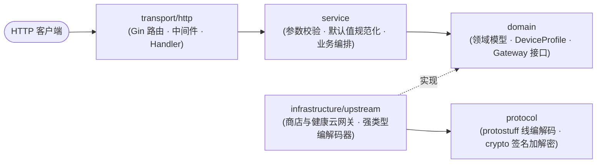

<div align="center">


# OWAS-API

**基于 Go 1.27.4 与 Gin 构建的高性能、低耦合 OPPO 应用商店手表版（`com.heytap.wearable.market`）RESTful API 服务。**

[](https://go.dev/)
[](https://gin-gonic.com/)
[](#接口文档)
[](https://www.gnu.org/licenses/agpl-3.0.html)

[English](README.md) · **简体中文**

</div>

---

## 项目简介

**OWAS-API** 为 **OPPO 应用商店手表版**（`com.heytap.wearable.market`，协议基线版本 `8.0.0.23_90d713a_260910`）提供标准、统一且强类型的 **RESTful JSON API** 服务。

项目遵循标准 Go 工程布局与 Clean Architecture 分层解耦架构，内部透明封装了二进制 Protostuff 编解码、动态请求签名、多态卡片反序列化与 RSA / AES-256-GCM 密钥协商能力——**无需 `protoc` 编译器**，**无需任何第三方加密库**。

### 核心特性

- **全量商店能力覆盖** — 支持应用搜索（模糊/精确）、首页分页卡片流、专题/合集详情、按 ID/包名查询应用详情、获取 APK 签名下载链接与 MD5 校验、批量更新检查、隐私与用户协议获取、付费订单与已购状态管理、云控开关查询以及对称密钥协商。
- **按请求动态模拟手表设备** — 通过标准 HTTP 请求头即可按请求切换圆表/方表形态、Android/iOS 配对端视角、语言区域与固件版本。
- **极简依赖** — 仅直接引入 `github.com/gin-gonic/gin`；Protostuff 线格式编解码、MD5/HMAC-SHA256 签名、XXTEA、RSA-PKCS1v15、AES-256-GCM、`slog` 结构化日志与优雅停机均基于 Go 1.27.4 标准库原生实现。
- **高内聚、低耦合、易扩展** — 严格单向依赖倒置（`transport -> service -> domain <- infrastructure`），可零侵入扩展缓存、限流、熔断或自定义适配器。

---

## 目录

- [架构设计](#架构设计)
- [快速开始](#快速开始)
- [配置说明](#配置说明)
- [接口规范](#接口规范)
  - [统一响应格式](#统一响应格式)
  - [状态码与错误码](#状态码与错误码)
  - [设备上下文与鉴权请求头](#设备上下文与鉴权请求头)
- [接口文档](#接口文档)
  - [接口总览](#接口总览)
  - [系统健康检查](#1-系统健康检查)
  - [应用商店接口](#2-应用商店接口)
  - [健康云接口](#3-健康云接口)
- [枚举值与扩展参考](#枚举值与扩展参考)
- [开源协议](#开源协议)
- [免责声明](#免责声明)

---

## 架构设计



```text
OWAS-API/
├── assets/
│   └── avatar.png                   # 项目头像
├── cmd/server/
│   └── main.go                      # 薄入口：配置加载、依赖注入装配与优雅停机
├── internal/
│   ├── config/                      # 环境变量解析与校验
│   ├── domain/                      # 领域实体、DeviceProfile 值对象、领域错误、Gateway 抽象接口
│   ├── protocol/
│   │   ├── protostuff/              # 零依赖 Protostuff 线格式编解码器（支持 Tag 127 多态/Map/Group）
│   │   └── crypto/                  # 标准库 MD5、XXTEA、HMAC-SHA256、RSA-PKCS1v15、AES-256-GCM
│   ├── infrastructure/upstream/     # HTTP 网关实现与强类型 Protostuff/JSON 编解码器
│   ├── service/                     # 输入校验、默认值填充与业务状态语义映射
│   └── transport/http/
│       ├── router.go                # Gin 路由树与全局中间件链
│       ├── response/                # 统一 JSON Envelope 与领域错误 -> HTTP 状态码映射
│       ├── middleware/              # X-Request-ID、slog 结构化访问日志、设备上下文解析
│       └── handler/                 # 应用商店、健康云与健康检查 RESTful Handler
├── tests/
│   └── live_verify_test.go          # 全量接口在线实测验证套件（-tags=live）
├── .env.example                     # 环境变量配置示例
├── go.mod                           # Go 1.27.4 模块声明
├── README.md                        # 英文文档
└── README_ZH.md                     # 中文文档
```

---

## 快速开始

### 环境要求

- **Go `1.27.4`** 及以上版本

### 本地运行

```bash
# 1. 进入模块目录
cd OWAS-API

# 2. 下载依赖
go mod download

# 3. 启动 HTTP 服务（默认监听 http://0.0.0.0:8080）
go run ./cmd/server
```

### 编译发布二进制

```bash
go build -ldflags="-s -w" -o bin/owas-api ./cmd/server
./bin/owas-api
```

### 运行测试

```bash
# 运行全部离线单元测试与路由集成测试（快速且无需外部网络）
go test -v ./...

# 静态代码检查
go vet ./...

# 运行全量在线端到端实测验证（需联网）
go test -v -count=1 -tags=live ./tests/...
```

---

## 配置说明

所有运行参数均通过环境变量配置（完整模板参见 [.env.example](.env.example)）：

| 环境变量 | 默认值 | 说明 |
| :--- | :--- | :--- |
| `OWAS_HOST` | `0.0.0.0` | HTTP 服务监听主机地址 |
| `OWAS_PORT` | `8080` | HTTP 服务监听端口（`1`–`65535`） |
| `GIN_MODE` | `release` | Gin 运行模式：`debug`、`release` 或 `test` |
| `OWAS_READ_TIMEOUT` | `15s` | HTTP 读超时（Go duration 格式） |
| `OWAS_WRITE_TIMEOUT` | `30s` | HTTP 写超时 |
| `OWAS_IDLE_TIMEOUT` | `60s` | HTTP Keep-Alive 空闲超时 |
| `OWAS_SHUTDOWN_TIMEOUT` | `10s` | 优雅停机排空等待超时 |
| `OWAS_UPSTREAM_TIMEOUT` | `20s` | 单次后端商店/云服务请求超时 |
| `OWAS_DEFAULT_WATCH_TYPE` | `2` | 默认表盘形态：`2`（圆表）或 `1`（方表） |
| `OWAS_DEFAULT_SUPPORT` | `android-oppo` | 默认配对手机类型：`android-oppo`、`android-others` 或 `ios` |
| `OWAS_DEFAULT_LOCALE` | `zh-CN;CN` | 默认手表语言与区域（`<languageTag>;<country>`） |
| `OWAS_DEFAULT_BRAND` | `OPPO` | 默认模拟手表品牌 |
| `OWAS_DEFAULT_PRODUCT` | `OWW251` | 默认模拟手表产品代号 |
| `OWAS_DEFAULT_MODEL` | `OWW251` | 默认模拟手表型号 |
| `OWAS_DEFAULT_SDK_INT` | `30` | 默认 Android SDK 版本号（`> 0`） |
| `OWAS_DEFAULT_ANDROID_RELEASE` | `11` | 默认 Android 系统版本 |
| `OWAS_DEFAULT_HEY_RELEASE` | `4.0` | 默认穿戴系统框架版本 |
| `OWAS_DEFAULT_COLOR_OS_VER` | `16` | 默认 ColorOS Watch 版本号 |
| `OWAS_DEFAULT_SYS_VER` | `OWW251_11_A.319` | 默认固件构建版本号 |
| `OWAS_DEFAULT_LINKAGE` | `1` | 默认配对模式：`1`（普通配对）或 `0`（家庭设备配对） |
| `OWAS_DEFAULT_PLAT_CODE` | `0` | 默认快应用引擎 `versionCode`（`>= 0`） |
| `OWAS_DEFAULT_INSTANT_SW_CLOSE` | `0` | 默认快应用开关：`0`（开启）或 `1`（关闭） |
| `OWAS_DEFAULT_TOKEN` | `""` | 可选的默认 HeyTap 账号 `accessToken` |

> [!TIP]
> 如需在本地 Mock 或私有代理环境中使用，可通过 `OWAS_APPSTORE_BASE_URL` 与 `OWAS_HEALTH_CLOUD_BASE_URL` 覆写默认服务地址。

---

## 接口规范

### 统一响应格式

所有接口均返回结构统一的 UTF-8 JSON 数据，并携带全局链路追踪 ID `requestId`（同时通过响应头 `X-Request-ID` 回传）。

**成功响应（`200 OK` / `201 Created`）**

```json
{
  "code": "OK",
  "message": "success",
  "requestId": "9a7f3c8e2b1d4a5f8e9c0d1a2b3c4d5e",
  "data": { }
}
```

**错误响应（`4xx` / `5xx`）**

```json
{
  "code": "INVALID_ARGUMENT",
  "message": "query parameter 'word' is required",
  "requestId": "9a7f3c8e2b1d4a5f8e9c0d1a2b3c4d5e",
  "details": {
    "field": "word"
  }
}
```

### 状态码与错误码

| HTTP 状态码 | `code` | 含义 |
| :-: | :--- | :--- |
| `200` | `OK` | 请求处理成功 |
| `201` | `OK` | 资源创建成功（付费应用订单） |
| `400` | `INVALID_ARGUMENT` | Query、Path、JSON 请求体或 `X-Watch-*` 请求头参数非法 |
| `401` | `UNAUTHORIZED` | 缺少、过期或无效的 HeyTap 账号令牌 |
| `404` | `NOT_FOUND` | 请求的应用、包名或版本下载资源不存在 / 已下架 |
| `404` | `ROUTE_NOT_FOUND` | 访问的路由不存在 |
| `405` | `METHOD_NOT_ALLOWED` | 当前路径不支持该 HTTP 方法 |
| `502` | `UPSTREAM_ERROR` | 商店服务返回异常状态码、协议解码失败或业务异常码 |
| `504` | `UPSTREAM_TIMEOUT` | 后端请求超过 `OWAS_UPSTREAM_TIMEOUT` 超时 |
| `500` | `INTERNAL_ERROR` | 服务内部未知错误 |

### 设备上下文与鉴权请求头

全部 `/api/v1/*` 接口均支持通过可选 HTTP 请求头按单次请求动态覆盖默认手表设备参数；传入非法枚举值时将快速返回 `400 Bad Request`。

| 请求头 | 可选值 / 格式 | 默认值 | 说明 |
| :--- | :--- | :--- | :--- |
| `X-Watch-Type` | `"1"`、`"2"` | `"2"` | 表盘屏幕形态：**`1`** = 方表，**`2`** = 圆表。*会影响商店应用列表过滤。* |
| `X-Watch-Support` | `"android-oppo"`、`"android-others"`、`"ios"` | `"android-oppo"` | 配对手机端类型：**`android-oppo`**（最全应用库）、**`android-others`**（其他品牌 Android）、**`ios`**（仅返回兼容 iOS 配对的应用）。*会影响商店应用列表过滤。* |
| `X-Watch-Locale` | `<langTag>;<country>` | `"zh-CN;CN"` | 语言与国家/地区标识 |
| `X-Watch-Brand` | 字符串 | `"OPPO"` | 手表品牌 |
| `X-Watch-Product` | 字符串 | `"OWW251"` | 手表产品代号 |
| `X-Watch-Model` | 字符串 | `"OWW251"` | 手表设备型号 |
| `X-Watch-SDK-Int` | 正整数（`> 0`） | `30` | Android API Level |
| `X-Watch-Android-Release` | 字符串 | `"11"` | Android 系统版本 |
| `X-Watch-Hey-Release` | 字符串 | `"4.0"` | 穿戴系统框架版本 |
| `X-Watch-ColorOS-Ver` | 字符串 | `"16"` | ColorOS Watch 大版本号 |
| `X-Watch-Sys-Ver` | 字符串 | `"OWW251_11_A.319"` | 系统固件构建版本 |
| `X-Watch-Linkage` | `"0"`、`"1"` | `"1"` | 配对模式：**`0`** = 家庭设备配对模式，**`1`** = 普通配对模式 |
| `X-Watch-Plat-Code` | 非负整数（`>= 0`） | `0` | 快应用引擎版本号（`0` 表示未安装） |
| `X-Watch-Instant-Sw-Close` | `"0"`、`"1"` | `"0"` | 快应用开关标记：**`0`** = 开启快应用，**`1`** = 关闭快应用 |
| `Authorization` | `Bearer <accessToken>` | *（无）* | HeyTap 账号令牌（订单、已购查询与付费校验接口必填） |
| `X-HeyTap-Token` | `<accessToken>` | *（无）* | 备选 HeyTap 令牌头（同时传入时优先于 `Authorization`） |
| `X-Request-ID` | 字符串（`<= 128` 字符） | *（自动生成 UUID）* | 自定义链路追踪 ID，将在响应头与响应体中原样回传 |

> [!NOTE]
> 应用商店服务端会根据 `X-Watch-Type` 与 `X-Watch-Support` 对返回结果进行适配过滤。例如搜索 `"微信"` 时，`X-Watch-Type: 2` + `X-Watch-Support: android-oppo` 返回最完整的列表，而切换为 `X-Watch-Type: 1`（方表）或 `X-Watch-Support: ios` 时会自动过滤不适配的应用。

---

## 接口文档

### 接口总览

| 方法 | 路径 | 说明 | 鉴权 |
| :-: | :--- | :--- | :-: |
| `GET` | [`/healthz`](#get-healthz) | 服务健康检查与运行时信息 | 公开 |
| `GET` | [`/api/v1/apps`](#1-搜索手表应用) | 按关键词搜索手表应用 | 公开 |
| `GET` | [`/api/v1/apps/:appId`](#2-按-appid-获取应用详情) | 按数字 `appId` 获取应用完整详情 | 公开 |
| `GET` | [`/api/v1/packages/:pkgName`](#3-按包名获取应用详情) | 按 Android 包名获取应用完整详情 | 公开 |
| `GET` | [`/api/v1/apps/:appId/versions/:verId/download`](#4-获取-apk-下载信息与校验值) | 获取带临时签名的 APK CDN 下载链接与 MD5 | 公开 |
| `POST` | [`/api/v1/updates/check`](#5-批量检查应用更新) | 批量检测已安装应用是否存在更新 | 公开 |
| `GET` | [`/api/v1/home`](#6-获取首页分页卡片流) | 获取商店首页分页卡片流 | 公开 |
| `GET` | [`/api/v1/subjects/:subjectId`](#7-获取专题合集详情) | 获取指定专题/合集页面卡片 | 公开 |
| `GET` | [`/api/v1/protocols`](#8-获取隐私政策与用户协议) | 获取隐私政策与用户协议链接及版本号 | 公开 |
| `POST` | [`/api/v1/orders`](#9-创建付费应用订单) | 创建付费手表应用订单 | **需 Token** |
| `GET` | [`/api/v1/orders/:orderId`](#10-查询订单支付状态) | 查询已有订单的支付状态 | **需 Token** |
| `GET` | [`/api/v1/payments/status`](#11-批量查询应用已购状态) | 批量查询应用是否已购买 | **需 Token** |
| `GET` | [`/api/v1/health-cloud/switches/:switchType`](#1-查询云控开关状态) | 查询云控开关及解析后的配置 JSON | 公开 |
| `POST` | [`/api/v1/health-cloud/pay-checks`](#2-第三方付费应用授权校验) | 第三方付费应用授权校验（支持自动 RSA + AES-GCM） | **需 Token** |
| `POST` | [`/api/v1/health-cloud/symmetric-keys/exchange`](#3-对称密钥协商) | 协商 AES-256-GCM 对称加密密钥 | 公开 |

---

### 1. 系统健康检查

#### `GET /healthz`

返回服务存活状态、版本号及当前 Go 运行时版本。

```bash
curl -s http://localhost:8080/healthz
```

<details>
<summary><b>示例响应 — <code>200 OK</code></b></summary>

```json
{
  "code": "OK",
  "message": "success",
  "requestId": "4f8a9c12d3e44567890abcdef1234567",
  "data": {
    "goVersion": "go1.27.4",
    "service": "owas-api",
    "status": "ok",
    "version": "1.0.0"
  }
}
```

</details>

---

### 2. 应用商店接口

#### 1. 搜索手表应用

`GET /api/v1/apps`

按关键词搜索手表应用，单次请求返回全量匹配结果（无分页）。

| 位置 | 参数名 | 类型 | 必填 | 默认值 | 可选值与说明 |
| :--- | :--- | :--- | :-: | :--- | :--- |
| Query | `word` | `string` | **是** | — | 搜索关键词（需 UTF-8 URL 编码），不可为空白字符串 |
| Query | `type` | `int` | 否 | `0` | 搜索匹配模式：<br>**`0`** = 模糊 / 全文检索（匹配名称、简介与相关词，默认推荐）<br>**`1`** = 精确匹配（仅返回应用名完全匹配项）<br>**`2`** = 扩展检索模式（行为与 `0` 一致） |

```bash
# 模糊搜索（默认圆表 + android-oppo 视角）
curl -s "http://localhost:8080/api/v1/apps?word=%E5%BE%AE%E4%BF%A1&type=0"

# 精确搜索（切换为方表 + iOS 配对过滤视角）
curl -s -H "X-Watch-Type: 1" -H "X-Watch-Support: ios" \
  "http://localhost:8080/api/v1/apps?word=%E5%BE%AE%E4%BF%A1&type=1"
```

<details>
<summary><b>示例响应 — <code>200 OK</code></b></summary>

```json
{
  "code": "OK",
  "message": "success",
  "requestId": "b8c4e0f2a1d34567890123456789abcd",
  "data": {
    "apps": [
      {
        "appId": 31617863,
        "verId": 25869985,
        "appName": "微信",
        "pkgName": "com.tencent.watchwechat",
        "verName": "1.0.7",
        "verCode": 65543,
        "iconUrl": "https://watch.heytapimage.com/img/202403/26/d1d6f65e5b89ec3612d48cc233c3d87b.png",
        "size": 56637679,
        "sizeDesc": "54.0MB",
        "dlCount": 0,
        "desc": "通过微信手表版可以实时获取消息通知并回复，以及通过微信支付进行付款，帮助你轻松连接全球好友。",
        "screenshots": [
          "https://watch.heytapimage.com/img/202403/26/da0b3d7b04e73bc7482cf06780fa7a33.png"
        ],
        "md5": "ca4be7d3a8f73ac064186b3db8fafb95",
        "shortDesc": "微信手表版",
        "onlineTime": 1785916638000,
        "type": 12,
        "englishName": "Wechat",
        "privacyPolicy": "https://weixin.qq.com/cgi-bin/readtemplate?lang=zh_CN&t=weixin_agreement&s=privacy",
        "privacyRights": "录音或通话录音,数据网络开关,WLAN网络开关,使用摄像头,蓝牙开关",
        "versionExplain": "修复了一些已知问题。",
        "iphoneLink": 2,
        "iphoneLinkDetail": "微信 8.0.48",
        "ageRating": "12+",
        "payment": 0,
        "price": 0,
        "isBought": 0
      }
    ],
    "isEnd": 0
  }
}
```

</details>

---

#### 2. 按 appId 获取应用详情

`GET /api/v1/apps/:appId`

按数字 `appId` 获取应用基础信息、开发者信息与分类权限清单。当应用不存在或已下架时返回 `404 NOT_FOUND`。

| 位置 | 参数名 | 类型 | 必填 | 默认值 | 可选值与说明 |
| :--- | :--- | :--- | :-: | :--- | :--- |
| Path | `appId` | `int64` | **是** | — | 正整数应用唯一 ID（如 `31617863`） |
| Query | `appType` | `int` | 否 | `1` | 应用类型：<br>**`1`** = 普通 APK 应用<br>**`2`** = 快应用（Instant App） |
| Query | `query` | `int` | 否 | `0` | 非负查询标记（常规客户端固定传 `0`） |
| Query | `module` | `string` | 否 | `"home"` | 来源模块标识：`"home"`、`"topic"`、`"search"`、`"download"`、`"upgrade"`、`"notification"`、`"action"`、`"mmi"` 或 `""` |

```bash
curl -s "http://localhost:8080/api/v1/apps/31617863?appType=1&module=search"
```

<details>
<summary><b>示例响应 — <code>200 OK</code> 与 <code>404 Not Found</code></b></summary>

**`200 OK`**

```json
{
  "code": "OK",
  "message": "success",
  "requestId": "c1d2e3f4a5b64789901234567890abcd",
  "data": {
    "base": {
      "appId": 31617863,
      "verId": 25869985,
      "appName": "微信",
      "pkgName": "com.tencent.watchwechat",
      "verName": "1.0.7",
      "verCode": 65543,
      "iconUrl": "https://watch.heytapimage.com/img/202403/26/d1d6f65e5b89ec3612d48cc233c3d87b.png",
      "size": 56637679,
      "sizeDesc": "54.0MB",
      "dlCount": 0,
      "md5": "ca4be7d3a8f73ac064186b3db8fafb95",
      "shortDesc": "微信手表版",
      "onlineTime": 1785916638000,
      "type": 12,
      "ageRating": "12+",
      "payment": 0,
      "price": 0,
      "isBought": 0
    },
    "developer": {
      "releaseTime": 1785916638000,
      "pkgPermiss": "android.permission.INTERNET,android.permission.RECORD_AUDIO",
      "developer": "深圳市腾讯计算机系统有限公司"
    },
    "permissionDto": {
      "basePermission": [
        "查看WLAN连接",
        "完全的网络访问权限"
      ],
      "privacyPermission": [
        "录音",
        "拍摄照片和视频"
      ]
    }
  }
}
```

**`404 Not Found`**（`appId` 不存在或已下架）

```json
{
  "code": "NOT_FOUND",
  "message": "store.appDetailByID: resource not found",
  "requestId": "d4e5f6a7b8c9401234567890abcdef12"
}
```

</details>

---

#### 3. 按包名获取应用详情

`GET /api/v1/packages/:pkgName`

按 Android 包名获取应用完整详情。当包名未被商店收录时返回 `404 NOT_FOUND`。

| 位置 | 参数名 | 类型 | 必填 | 默认值 | 可选值与说明 |
| :--- | :--- | :--- | :-: | :--- | :--- |
| Path | `pkgName` | `string` | **是** | — | Android 应用包名（如 `com.tencent.watchwechat`） |
| Query | `query` | `int` | 否 | `0` | 非负查询标记（默认 `0`） |
| Query | `module` | `string` | 否 | `"action"` | 来源模块标识（同上，DeepLink 跳转场景默认 `"action"`） |

```bash
curl -s "http://localhost:8080/api/v1/packages/com.tencent.watchwechat?module=action"
```

<details>
<summary><b>示例响应 — <code>200 OK</code></b></summary>

```json
{
  "code": "OK",
  "message": "success",
  "requestId": "1122334455664778899aabbccddeeff0",
  "data": {
    "base": {
      "appId": 31617863,
      "verId": 25869985,
      "appName": "微信",
      "pkgName": "com.tencent.watchwechat",
      "verName": "1.0.7",
      "verCode": 65543,
      "size": 56637679,
      "sizeDesc": "54.0MB",
      "type": 12,
      "payment": 0,
      "price": 0,
      "isBought": 0
    },
    "developer": {
      "releaseTime": 1785916638000,
      "developer": "深圳市腾讯计算机系统有限公司"
    },
    "permissionDto": {
      "basePermission": ["完全的网络访问权限"],
      "privacyPermission": ["录音"]
    }
  }
}
```

</details>

---

#### 4. 获取 APK 下载信息与校验值

`GET /api/v1/apps/:appId/versions/:verId/download`

获取带临时签名的真实 APK CDN 下载地址、整包 MD5 与文件头 MD5 校验值。资源不存在或不可下载时返回 `404 NOT_FOUND`。

| 位置 | 参数名 | 类型 | 必填 | 默认值 | 可选值与说明 |
| :--- | :--- | :--- | :-: | :--- | :--- |
| Path | `appId` | `int64` | **是** | — | 正整数应用 ID |
| Path | `verId` | `int64` | **是** | — | 正整数版本 ID（取自应用信息中的 `verId`） |
| Query | `type` | `string` | 否 | `"1"` | 下载场景类型：<br>**`"1"`** = 普通下载<br>**`"2"`** = 手动更新<br>**`"3"`** = 自动后台更新 |
| Query | `retry` | `int` | 否 | `2` | 重试计数（取值范围 `1`–`10`，官方客户端首次请求传 `2`） |

```bash
curl -s "http://localhost:8080/api/v1/apps/31617863/versions/25869985/download?type=1&retry=2"
```

<details>
<summary><b>示例响应 — <code>200 OK</code></b></summary>

```json
{
  "code": "OK",
  "message": "success",
  "requestId": "2233445566774889900aabbccddeeff1",
  "data": {
    "appId": 31617863,
    "verId": 25869985,
    "downUrl": "https://storefs1.nearme.com.cn/apk/202608/05/0bc75460de852adca20691f214fc30a3.apk?sign=...&t=...",
    "md5": "ca4be7d3a8f73ac064186b3db8fafb95",
    "headerMd5": "95d7eb481596fc790fc40ca436c03e9a",
    "pkgName": "com.tencent.watchwechat"
  }
}
```

</details>

---

#### 5. 批量检查应用更新

`POST /api/v1/updates/check`

单次最多提交 200 个已安装应用的包名与版本号，批量检测更新。

| 字段名 | 类型 | 必填 | 约束与说明 |
| :--- | :--- | :-: | :--- |
| `apps` | `array<object>` | **是** | 待检测列表，长度 `1`–`200` |
| `apps[].pkgName` | `string` | **是** | 已安装 Android 包名 |
| `apps[].verCode` | `string` | **是** | 已安装整型 `versionCode` 的十进制字符串（如 `"1"`） |

> [!NOTE]
> 对已收录的包名，返回项中的 `upgradeFlag` 字段含义为：**`1`** = 存在可更新的新版本；**`0`** = 已是最新版本（仍会返回该应用最新元数据）。未被商店收录的包名不会出现在 `upgrades` 列表中。

```bash
curl -s -X POST http://localhost:8080/api/v1/updates/check \
  -H "Content-Type: application/json" \
  -d '{
    "apps": [
      { "pkgName": "com.tencent.watchwechat", "verCode": "1" },
      { "pkgName": "com.koudaistory.watch", "verCode": "999999" }
    ]
  }'
```

<details>
<summary><b>示例响应 — <code>200 OK</code></b></summary>

```json
{
  "code": "OK",
  "message": "success",
  "requestId": "3344556677884990011aabbccddeeff2",
  "data": {
    "upgrades": [
      {
        "appId": 31617863,
        "verId": 25869985,
        "appName": "微信",
        "pkgName": "com.tencent.watchwechat",
        "verName": "1.0.7",
        "verCode": 65543,
        "size": 56637679,
        "sizeDesc": "54.0MB",
        "md5": "ca4be7d3a8f73ac064186b3db8fafb95",
        "type": 12,
        "payment": 0,
        "price": 0,
        "isBought": 0,
        "updateDesc": "修复了一些已知问题。",
        "upgradeFlag": 1
      },
      {
        "appId": 31618001,
        "verId": 25870100,
        "appName": "口袋故事",
        "pkgName": "com.koudaistory.watch",
        "verName": "2.3.1",
        "verCode": 20301,
        "size": 18245120,
        "sizeDesc": "17.4MB",
        "type": 12,
        "payment": 0,
        "price": 0,
        "isBought": 0,
        "upgradeFlag": 0
      }
    ]
  }
}
```

</details>

---

#### 6. 获取首页分页卡片流

`GET /api/v1/home`

分页拉取商店首页卡片流，支持自动识别多态卡片（`NavCardDto`、`BannerCardDto`、`ResourceListCardDto`）并还原各自字段。

| 位置 | 参数名 | 类型 | 必填 | 默认值 | 可选值与说明 |
| :--- | :--- | :--- | :-: | :--- | :--- |
| Query | `start` | `int` | 否 | `0` | 卡片偏移量（`>= 0`，推荐按 `0, 10, 20...` 递增） |
| Query | `size` | `int` | 否 | `10` | 每页卡片数量（取值范围 `1`–`100`） |

> [!TIP]
> 当响应中 `data.isEnd == 1` 时表示已到达最后一页。卡片或 Banner 的 `actionParam` 若包含 `pk=6000<id>`，去掉前缀 `6000` 即为可用于「专题详情」接口的 `subjectId`（例如 `pk=600087` -> `subjectId = 87`）。

```bash
curl -s "http://localhost:8080/api/v1/home?start=0&size=10"
```

<details>
<summary><b>示例响应 — <code>200 OK</code></b></summary>

```json
{
  "code": "OK",
  "message": "success",
  "requestId": "4455667788994001122aabbccddeeff3",
  "data": {
    "pageKey": 100,
    "isEnd": 0,
    "cards": [
      {
        "_type": "com.heytap.appstore.watch.domain.v2.NavCardDto",
        "code": 1001,
        "key": 5001,
        "banners": [
          {
            "id": 9001,
            "image": "https://watch.heytapimage.com/img/202609/banner.png",
            "imageWidth": 720,
            "imageHeight": 360,
            "actionParam": "oap://mk/cardstyle?pk=600087",
            "title": "最近上新",
            "sort": 1
          }
        ]
      },
      {
        "_type": "com.heytap.appstore.watch.domain.v2.ResourceListCardDto",
        "code": 1002,
        "key": 600060,
        "actionParam": "oap://mk/cardstyle?pk=600060",
        "title": "推荐应用",
        "resources": [
          {
            "appId": 31617863,
            "verId": 25869985,
            "appName": "微信",
            "pkgName": "com.tencent.watchwechat",
            "verName": "1.0.7",
            "verCode": 65543,
            "size": 56637679,
            "sizeDesc": "54.0MB",
            "type": 12,
            "payment": 0,
            "price": 0,
            "isBought": 0
          }
        ]
      }
    ]
  }
}
```

</details>

---

#### 7. 获取专题/合集详情

`GET /api/v1/subjects/:subjectId`

获取指定专题/合集页面（如「最近上新」「运动健康」「实用工具」）的卡片与应用列表。

| 位置 | 参数名 | 类型 | 必填 | 默认值 | 可选值与说明 |
| :--- | :--- | :--- | :-: | :--- | :--- |
| Path | `subjectId` | `int64` | **是** | — | 正整数专题 ID（从首页卡片 `actionParam` 的 `pk=6000{id}` 截取，如 `87`、`60`） |

```bash
curl -s "http://localhost:8080/api/v1/subjects/87"
```

<details>
<summary><b>示例响应 — <code>200 OK</code></b></summary>

```json
{
  "code": "OK",
  "message": "success",
  "requestId": "5566778899004112233aabbccddeeff4",
  "data": {
    "pageKey": 101,
    "isEnd": 1,
    "cards": [
      {
        "_type": "com.heytap.appstore.watch.domain.v2.ResourceListCardDto",
        "code": 1006,
        "key": 600087,
        "title": "最近上新",
        "resources": [
          {
            "appId": 37627586,
            "verId": 26104210,
            "appName": "腕上实验室",
            "pkgName": "com.example.watchlab",
            "verName": "1.2.0",
            "verCode": 120,
            "size": 8421376,
            "sizeDesc": "8.0MB",
            "type": 12,
            "payment": 1,
            "price": 600,
            "isBought": 0
          }
        ]
      }
    ]
  }
}
```

</details>

---

#### 8. 获取隐私政策与用户协议

`GET /api/v1/protocols`

获取商店隐私政策链接、用户协议链接以及当前隐私协议版本号。

| 位置 | 参数名 | 类型 | 必填 | 默认值 | 可选值与说明 |
| :--- | :--- | :--- | :-: | :--- | :--- |
| Query | `language` | `string` | 否 | `"zh_CN"` | 语言区域代码，如 `"zh_CN"`、`"en_US"` |

```bash
curl -s "http://localhost:8080/api/v1/protocols?language=zh_CN"
```

<details>
<summary><b>示例响应 — <code>200 OK</code></b></summary>

```json
{
  "code": "OK",
  "message": "success",
  "requestId": "6677889900114223344aabbccddeeff5",
  "data": {
    "privacy": "https://activity-cdo.heytapimage.com/cdo-activity/static/202205/23/store-VersionControl/latest.html?c=0&agreementType=5",
    "agreement": "https://cdofs.oppomobile.com/cdo-activity/static/2019/heytap/china/store/agreement.html?uLang=zh_CN",
    "privacyVersion": 1
  }
}
```

</details>

---

#### 9. 创建付费应用订单

`POST /api/v1/orders` · **`需要 HeyTap Token`**

为付费手表应用创建支付订单。

> [!IMPORTANT]
> 本接口需要有效的 HeyTap 账号 `accessToken`（可通过 `Authorization: Bearer <token>`、`X-HeyTap-Token` 或 JSON 请求体中的 `token` 字段传入，服务会自动保持请求头与请求体中的令牌一致）。令牌缺失或校验失败将返回 `401 UNAUTHORIZED`。

| 字段名 | 类型 | 必填 | 约束与说明 |
| :--- | :--- | :-: | :--- |
| `appId` | `int64` | **是** | 正整数付费应用 ID |
| `price` | `int32` | **是** | 价格，单位为**分**（`>= 0`，例如 `600` 代表 ¥6.00） |
| `productName` | `string` | **是** | 商品名称（通常为 `appName`） |
| `productDesc` | `string` | **是** | 商品描述（通常为 `pkgName`） |
| `token` | `string` | 否 | 可选 HeyTap `accessToken`（未传时自动使用请求头令牌） |
| `model` | `string` | 否 | 可选预留设备型号字段 |
| `ip` | `string` | 否 | 可选预留客户端 IP 字段 |

```bash
curl -s -X POST http://localhost:8080/api/v1/orders \
  -H "Authorization: Bearer <your_heytap_token>" \
  -H "Content-Type: application/json" \
  -d '{
    "appId": 37627586,
    "price": 600,
    "productName": "腕上实验室",
    "productDesc": "com.example.watchlab"
  }'
```

<details>
<summary><b>示例响应 — <code>201 Created</code> 与 <code>401 Unauthorized</code></b></summary>

**`201 Created`**

```json
{
  "code": "OK",
  "message": "created",
  "requestId": "7788990011224334455aabbccddeeff6",
  "data": {
    "orderId": "20261118193000123456",
    "payUrl": "https://pay.heytap.com/qr?token=...",
    "expireTime": "2026-11-18 19:45:00",
    "prePayToken": "prepay_token_example",
    "partnerCode": "PARTNER_001",
    "userId": "1000123456"
  }
}
```

**`401 Unauthorized`**（未携带有效 Token）

```json
{
  "code": "UNAUTHORIZED",
  "message": "token校验未通过",
  "requestId": "7788990011224334455aabbccddeeff7",
  "details": {
    "upstreamCode": "302",
    "upstreamMessage": "token校验未通过"
  }
}
```

</details>

---

#### 10. 查询订单支付状态

`GET /api/v1/orders/:orderId` · **`需要 HeyTap Token`**

轮询或查询指定付费订单的当前支付状态。

| 位置 | 参数名 | 类型 | 必填 | 默认值 | 可选值与说明 |
| :--- | :--- | :--- | :-: | :--- | :--- |
| Path | `orderId` | `string` | **是** | — | 创建订单时返回的订单号 |
| Query | `userId` | `string` | **是** | — | HeyTap 账号 `userId` / `ssoid` |
| Query | `appId` | `int64` | **是** | — | 正整数应用 ID |

```bash
curl -s -H "Authorization: Bearer <your_heytap_token>" \
  "http://localhost:8080/api/v1/orders/20261118193000123456?userId=1000123456&appId=37627586"
```

<details>
<summary><b>示例响应 — <code>200 OK</code></b></summary>

```json
{
  "code": "OK",
  "message": "success",
  "requestId": "8899001122334445566aabbccddeeff7",
  "data": {
    "appId": 37627586,
    "payStatus": 1
  }
}
```

> `payStatus` 完整状态值对照请参见 [PayStatus 枚举表](#paystatus)。

</details>

---

#### 11. 批量查询应用已购状态

`GET /api/v1/payments/status` · **`需要 HeyTap Token`**

批量查询当前登录账号是否已购买指定的一个或多个付费应用。

| 位置 | 参数名 | 类型 | 必填 | 默认值 | 可选值与说明 |
| :--- | :--- | :--- | :-: | :--- | :--- |
| Query | `appIds` | `string` | **是** | — | 英文逗号分隔的正整数 `appId` 列表（单次 `1`–`100` 个，如 `31617863,37627586`） |

```bash
curl -s -H "Authorization: Bearer <your_heytap_token>" \
  "http://localhost:8080/api/v1/payments/status?appIds=31617863,37627586"
```

<details>
<summary><b>示例响应 — <code>200 OK</code></b></summary>

```json
{
  "code": "OK",
  "message": "success",
  "requestId": "9900112233444556677aabbccddeeff8",
  "data": {
    "statusVOList": [
      { "appId": 31617863, "payStatus": 0 },
      { "appId": 37627586, "payStatus": 1 }
    ]
  }
}
```

</details>

---

### 3. 健康云接口

#### 1. 查询云控开关状态

`GET /api/v1/health-cloud/switches/:switchType`

查询远程功能云控开关配置。当 `body.config` 为合法 JSON 字符串时，服务会自动将其解析至 `body.parsedConfig` 字段。

| 位置 | 参数名 | 类型 | 必填 | 默认值 | 可选值与说明 |
| :--- | :--- | :--- | :-: | :--- | :--- |
| Path | `switchType` | `int` | **是** | — | 正整数云控开关类型 ID（如 **`116`** = 高功耗应用提示弹窗配置） |

```bash
curl -s "http://localhost:8080/api/v1/health-cloud/switches/116"
```

<details>
<summary><b>示例响应 — <code>200 OK</code></b></summary>

```json
{
  "code": "OK",
  "message": "success",
  "requestId": "aa11bb22cc33444556677889900aabb1",
  "data": {
    "errorCode": 0,
    "message": "成功",
    "body": {
      "switchStatus": 1,
      "config": "{\"showPowerDialog\":true}",
      "parsedConfig": {
        "showPowerDialog": true
      }
    }
  }
}
```

</details>

---

#### 2. 第三方付费应用授权校验

`POST /api/v1/health-cloud/pay-checks` · **`需要 HeyTap Token`**

校验第三方付费手表应用的购买授权，支持两种工作模式：

1. **自动托管加解密模式** — 仅传入 `publicKey`（不传 `cipher`）：服务自动生成 128-bit 随机 AES 密钥、以 `RSA/ECB/PKCS1Padding` 加密后发起校验，并自动以 AES-GCM 解密响应到 `decryptedBody`。
2. **密文透传模式** — 直接传入已加密的 `cipher`。

| 字段名 | 类型 | 必填 | 约束与说明 |
| :--- | :--- | :-: | :--- |
| `appId` | `int64` | **是** | 正整数付费应用 ID |
| `cipher` | `string` | 否 | 预加密的 `Base64(RSA(aesKey))` 字符串（托管模式下留空） |
| `publicKey` | `string` | 否 | Base64 编码的 X.509（SPKI DER）RSA 公钥（不传 `cipher` 时启用自动加解密） |

```bash
curl -s -X POST http://localhost:8080/api/v1/health-cloud/pay-checks \
  -H "Authorization: Bearer <your_heytap_token>" \
  -H "Content-Type: application/json" \
  -d '{
    "appId": 37627586,
    "publicKey": "<Base64_X509_RSA_Public_Key>"
  }'
```

<details>
<summary><b>示例响应 — <code>200 OK</code> 与 <code>401 Unauthorized</code></b></summary>

**`200 OK`**（传入 `publicKey` 自动解密）

```json
{
  "code": "OK",
  "message": "success",
  "requestId": "bb22cc33dd444556677889900aabbcc2",
  "data": {
    "errorCode": 0,
    "message": "成功",
    "body": "<Base64_AES_GCM_Ciphertext>",
    "decryptedBody": [
      {
        "appid": 37627586,
        "payStatus": 1
      }
    ]
  }
}
```

**`401 Unauthorized`**（未携带有效 Token）

```json
{
  "code": "UNAUTHORIZED",
  "message": "health.checkPay: valid HeyTap token required",
  "requestId": "bb22cc33dd444556677889900aabbcc3",
  "details": {
    "upstreamStatus": 403
  }
}
```

</details>

---

#### 3. 对称密钥协商

`POST /api/v1/health-cloud/symmetric-keys/exchange`

协商用于特殊加密应用下载的 256-bit 对称密钥。服务自动完成随机客户端密钥生成、RSA-PKCS1v15 请求加密、HMAC-SHA256 签名以及 AES-256-GCM 响应解密。

| 字段名 | 类型 | 必填 | 默认值 | 可选值与说明 |
| :--- | :--- | :-: | :--- | :--- |
| `encryptionAlgorithm` | `int` | 否 | `4` | 正整数加密算法标识（**`4`** = AES-256-GCM） |
| `firstExchangeKey` | `int` | 否 | `0` | 非负整数标记：**`0`** = 常规密钥协商，**`1`** = 首次密钥交换 |

> [!TIP]
> 请求体完全可选；发送空 Body 的 `POST` 请求即自动采用默认参数（`encryptionAlgorithm = 4`，`firstExchangeKey = 0`）。

```bash
# 使用默认参数（空 Body）
curl -s -X POST http://localhost:8080/api/v1/health-cloud/symmetric-keys/exchange

# 或显式指定参数
curl -s -X POST http://localhost:8080/api/v1/health-cloud/symmetric-keys/exchange \
  -H "Content-Type: application/json" \
  -d '{"encryptionAlgorithm": 4, "firstExchangeKey": 0}'
```

<details>
<summary><b>示例响应 — <code>200 OK</code></b></summary>

```json
{
  "code": "OK",
  "message": "success",
  "requestId": "cc33dd44ee5546677889900aabbccdd3",
  "data": {
    "errorCode": 0,
    "message": "成功",
    "body": "<Base64_AES_256_GCM_Envelope>",
    "decryptedBody": {
      "encryptionAlgorithm": 4,
      "symmetricKey": "a1b2c3d4e5f67890123456789abcdef0",
      "keyLength": 256,
      "publicKey": null,
      "publicKeyVersion": null
    }
  }
}
```

</details>

---

## 枚举值与扩展参考

<details>
<summary><b>展开查看响应字段枚举对照表与图片 CDN 缩略图规则</b></summary>

#### `Resource.type`（资源类型）

| 值 | 名称 | 说明 |
| :-: | :--- | :--- |
| `-1` | `UNKNOWN` | 未知类型 |
| `12` | `APP` | 普通手表 APK 应用 |
| `13` | `WATCH_FACE` | 表盘资源 |
| `14` | `INSTANT` | 快应用（Instant App） |

#### `Resource.payment` / `price` / `isBought`

| 字段 | 取值 | 说明 |
| :--- | :--- | :--- |
| `payment` | `0` = 免费，`1` = 付费 | 标识应用是否为付费应用 |
| `price` | 整数（单位：分） | 例如 `600` 表示 ¥6.00，`0` 表示免费 |
| `isBought` | `0` = 未购买，`1` = 已购买 | 当前账号的已购状态 |

#### `Card.code`（卡片类型）

| 值 | 名称 | 常见多态子类（`_type`） |
| :-: | :--- | :--- |
| `1001` | `BANNER` | `NavCardDto` |
| `1002` | `TOPIC_RESOURCE` | `ResourceListCardDto` |
| `1003` | `BANNER_RESOURCE` | `BannerCardDto` |
| `1005` | `ALL_RESOURCE` | `ResourceListCardDto` |
| `1006` | `TOPIC_RESOURCE_2` | `ResourceListCardDto` |
| `1007` | `BANNER_RESOURCE_INSTANT` | `BannerCardDto` |
| `1008` | `TOPIC_RESOURCE_INSTANT` | `ResourceListCardDto` |
| `1009` | `TOPIC_RESOURCE_2_INSTANT` | `ResourceListCardDto` |

#### `PayStatus`

| 值 | 状态 | 说明 |
| :-: | :--- | :--- |
| `0` | `ToBePaid` | 待支付 / 未购买 |
| `1` | `Success` | 支付成功 / 已购买 |
| `2` | `Fail` | 支付失败 |
| `3` | `Refund` | 退款处理中 |
| `4` | `RefundSuccess` | 退款成功 |
| `5` | `RefundFail` | 退款失败 |
| `6` | `Expired` | 订单已过期 |
| `7` | `PAID` | 已支付 |

#### 图片 CDN 缩放后缀规则

> [!TIP]
> 接口返回的 `iconUrl`、`screenshots[]` 与 `Banner.image` 为原图链接。前端或手表端展示时，可按以下规则拼接 WebP 压缩缩放参数以减小流量：
> - **普通 APK 图标（`type=12`）**：`{iconUrl}.w100-h100-q90.webp`
> - **快应用图标（`type=14`）**：`{iconUrl}?x-amz-process=image/resize,m_fill,h_100,w_100`
> - **应用详情截图**：`{screenshot}.w402-h476-q90.webp`
> - **Banner 大图**：`{image}.w{width}-h{height}-q90.webp`

</details>

---

## 开源协议

本项目基于 **GNU Affero General Public License v3.0（AGPL-3.0）** 开源，完整条款请查阅 [GNU AGPL v3.0 协议全文](./LICENSE)。

> [!NOTE]
> 根据 **AGPL-3.0** 协议要求，若您修改本项目代码并将其部署为面向用户的网络服务，必须同样以 AGPL-3.0 协议向交互用户提供修改后的完整对应源代码。

---

## 免责声明

> [!CAUTION]
> 本项目仅供**技术研究、协议互操作与学习交流**使用，与 OPPO 或 HeyTap 官方无任何隶属、授权或合作关系。请勿将本项目用于任何商业滥用、恶意爬取或违反相关法律法规及服务条款的行为。
